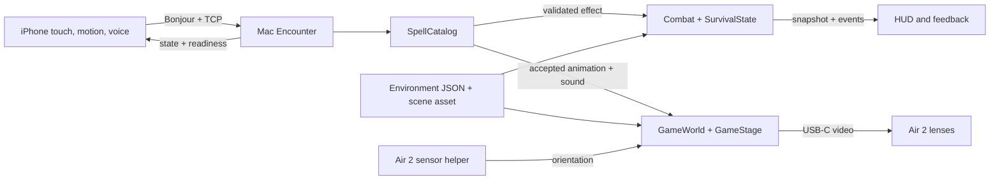

# Runtime architecture

The Mac owns the scene, simulation clock, enemies, allies, resources, and saved records.
The iPhone owns touch, motion, speech recognition, and controller feedback.
The Air 2 receives video directly from the Mac.
The Mac also accepts local keyboard movement and optional ARKit phone-position samples.

## Ownership

| Module | Responsibility |
| --- | --- |
| `ControllerLink` | Framed transport, validation, stale-input rejection, reconnection |
| `ControllerSession` | Phone input lifecycle and host snapshots |
| `Encounter` | Run/setup transitions and spell dispatch |
| `SpellCatalog` | Required spell components and shared invocation metadata |
| `Combat` | Spawn timing, contacts, projectiles, damage, rewards, simulation time |
| `SurvivalState` | HP, MP, stage level, score, persistent best records |
| `SummonCombat` | Explicit allies, health, attack timing, exclusivity, status effects |
| `GameWorld` | Environment, camera, head pose, AR visibility, room effects |
| `GameStage` | SceneKit rendering, wand, HUD, setup, game-over views |
| `SpellAudio` | Mixing and simulation-timed music |
| `CharacterAnimation` | Weighted rigs and independent skeletal playback |
| `PlayerMovement` | Keyboard movement, measured phone translation, calibration, and jump rejection |
| `PhonePositionTracking` | Opt-in ARKit session, camera permission, tracking quality, and gesture suspension |

## Simulation rules

Damage occurs at simulation contact time after a reach check.
Animations never independently decide damage.
The controller cannot set health, mana, score, or enemy state.
Reconnection resumes the same run and cancels stale held gestures.
Game-over stops combat while head tracking continues.
Each zombie awards 100 score once and does not grant XP.
A stage contains eight zombies with 2 HP each, spawning eight seconds apart at level 1.
Each later level multiplies the interval by 0.9, with a two-second minimum.
Clearing a stage awards 250 score and starts a twenty-second break.
The level counts stages, starting at level 1.
At the beginning of each subsequent stage, both resource maximums increase by 10 and HP and MP refill completely.
Clearing the stage does not trigger that refill.
The run starts with 100 HP and 100 MP.
Mana regenerates at 4 MP per simulation second after a two-second delay from spending.
Touch-down captures the current wand aim as the drawing origin, without moving it to the centre.
Zombie health retains fractions so fireball can divide its 5-damage budget among all blast victims.
Distance-based weights give nearer victims a larger share.
Zombie swipes and bites each deal 1 damage at level 1, increasing by 0.5 each level.
Wand melee, arrows, and physical ally attacks each deal 1 damage.
Lightning, ice, and devil fire breath each deal 2 damage.
Fireball divides 5 total damage across victims within a 3-metre blast.
Shield health absorbs damage before player health and has no duration.
A shield starts with 20 HP, costs 20 MP, and has a ten-second cooldown.
An active shield cannot be recast for a refill, and stage transitions do not refill it.
The devil is a winged flying ally.
Patronus runs on a curved path from the lower-right foreground, applies a fifteen-second slow, then vanishes.
Idle wand motion triggers a short-range melee contact through the same authoritative combat state.
Held drawing, setup, countdowns, pauses, and weapon changes suppress or reset melee recognition.
An incompatible summon removes existing allies only after availability and mana checks pass.

Rune and voice input share one dispatcher.
Combat effects remain in the authoritative simulation.
Accepted casts trigger animation and sound.
Rejected casts do not perform the accepted animation.
Timed music follows simulation duration so pauses and restarts cannot leave it playing.

## Player movement

The Mac polls Apple's Game Controller keyboard profile only while its window is active.
Without head tracking, WASD moves at 1.4 metres per second and arrow keys rotate the view.
Diagonal input is normalized, eye height stays fixed, and movement stays inside the configured floor bounds extended to include the initial camera position.
The same camera position drives enemy pursuit, melee reach, projectile origins, and shield placement.
Restart restores the camera's configured position.
Paused or restarted keyboard input requires a release before movement resumes.

Phone walking is off by default and controlled by a Mac toolbar toggle.
The host advertises optional `supportsPhonePosition` and `phoneWalkingEnabled` fields.
The phone sends the new `position` command only when the host advertises support and enables it.
Older peers therefore keep their existing commands and service identifiers.
Continuous position and idle wand samples are coalesced separately, preserving gesture and tracking-state barriers.

ARKit uses the rear camera and motion sensors to measure phone translation at approximately 30 updates per second.
Images are neither transmitted nor saved by this feature.
The host aligns the initial camera heading with the game view and applies smoothed horizontal deltas at one metre per metre.
It suppresses small jitter and rejects stale packets, large jumps, and invalid coordinates.
Limited or interrupted tracking, gestures, pauses, new origins, and reconnects rebase the position before movement resumes.
Drawing and the following 0.8 seconds suspend translation.
Head turns do not rotate an existing positional calibration.

The phone is a handheld tracking reference, so arm motion outside gesture capture can still affect position.
It is not a substitute for independently measured head position or obstacle detection.
Air 2 alone supplies no walking translation.

## Environments and AR

The environment defines its scene, floor, camera, lights, bounds, and spawn points.
Combat and companions use the same definition.
Only roots loaded from the environment asset are hidden in AR.
Runtime actors, lights, spells, and HUD remain visible.
Transparent scene pixels are presented over a black optical canvas.
The Air 2 has no camera feed in this configuration.

## Names and compatibility

The project, scheme, Swift module, helper, UI, launchers, and documentation use X Arcana or `XArcana`.
These old identifiers intentionally remain for upgrades:

- `local.emberarchive.wand` identifies the installed app and saved-data container.
- `_ember-wand._tcp` connects existing phone controllers.
- `_ember-head._tcp` connects installed head trackers.
- The helper's lock filename stays stable during an update.

Changing these identifiers requires a migration plan and paired device installation.
They are protocol and storage identifiers, not product names.
`RuntimeIdentifiers.swift` centralizes app service strings.
Original third-party titles and attribution are not renamed.

Player-facing levels identify stages, not XP progression.
Internal `wave` and `bestWave` wire and storage keys remain unchanged for compatibility.

## Build layout

One target selects the Mac host or phone controller at compile time.
Mac-only resource filters exclude models, textures, rigs, and game audio from the phone bundle.
`SyncProject.py` synchronizes source membership and resource folders without an external project-generator dependency.
Its `--check` mode fails when a new file is not registered.

## Revised summon and bow balance

The demon is invoked only by drawing a star.
It needs at least 20 MP to appear, has no upfront charge, and drains 20 MP per simulation second.
Mana regeneration pauses while it is active.
It disappears after five simulation seconds or when mana runs out.
Nyan needs 20 zombie defeats before every cast, including the first, and still costs 80 MP.
One living zombie becomes one cat; queued zombies do not produce extra cats.
Spawning pauses during the 27-second curse, then resumes after the current level's spawn interval.
Only transformed zombies disappear at the song boundary.
The glasses show Nyan progress out of 20.
The bow has a 0.4-second reload.
