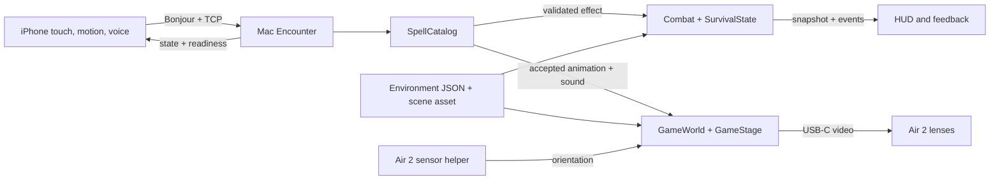

# Runtime architecture

The Mac owns the scene, simulation clock, enemies, allies, resources, and saved records.
The iPhone owns touch, motion, speech recognition, and controller feedback.
The Air 2 receives video directly from the Mac.

## Ownership

| Module | Responsibility |
| --- | --- |
| `ControllerLink` | Framed transport, validation, stale-input rejection, reconnection |
| `ControllerSession` | Phone input lifecycle and host snapshots |
| `Encounter` | Run/setup transitions and spell dispatch |
| `SpellCatalog` | Required spell components and shared invocation metadata |
| `Combat` | Spawn timing, contacts, projectiles, damage, rewards, simulation time |
| `SurvivalState` | HP, MP, XP, levels, score, persistent best records |
| `SummonCombat` | Explicit allies, health, attack timing, exclusivity, status effects |
| `GameWorld` | Environment, camera, head pose, AR visibility, room effects |
| `GameStage` | SceneKit rendering, wand, HUD, setup, game-over views |
| `SpellAudio` | Mixing and simulation-timed music |
| `CharacterAnimation` | Weighted rigs and independent skeletal playback |

## Simulation rules

Damage occurs at simulation contact time after a reach check.
Animations never independently decide damage.
The controller cannot set health, mana, score, or enemy state.
Reconnection resumes the same run and cancels stale held gestures.
Game-over stops combat while head tracking continues.
Each zombie awards score and XP once.
An incompatible summon removes existing allies only after availability and mana checks pass.

Rune and voice input share one dispatcher.
Combat effects remain in the authoritative simulation.
Accepted casts trigger animation and sound.
Rejected casts do not perform the accepted animation.
Timed music follows simulation duration so pauses and restarts cannot leave it playing.

## Environments and AR

The environment defines its scene, floor, camera, lights, bounds, and spawn points.
Combat and companions use the same definition.
Only roots loaded from the environment asset are hidden in AR.
Runtime actors, lights, spells, and HUD remain visible.
Transparent scene pixels are presented over a black optical canvas.
The Air 2 has no camera feed in this configuration.

## Names and compatibility

The project, scheme, Swift module, helper, UI, launchers, and documentation use X Arcana or `XArcana`.
These old identifiers intentionally remain for upgrades:

- `local.emberarchive.wand` identifies the installed app and saved-data container.
- `_ember-wand._tcp` connects existing phone controllers.
- `_ember-head._tcp` connects installed head trackers.
- The helper's lock filename stays stable during an update.

Changing these identifiers requires a migration plan and paired device installation.
They are protocol and storage identifiers, not product names.
`RuntimeIdentifiers.swift` centralizes app service strings.
Original third-party titles and attribution are not renamed.

## Build layout

One target selects the Mac host or phone controller at compile time.
Mac-only resource filters exclude models, textures, rigs, and game audio from the phone bundle.
`SyncProject.py` synchronizes source membership and resource folders without an external project-generator dependency.
Its `--check` mode fails when a new file is not registered.
