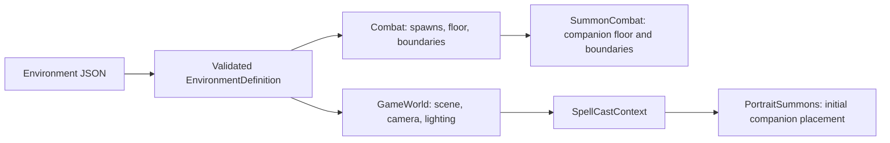

# Replace the game environment

X Arcana loads its hall from `XArcana/Resources/Environments/fantasy.json`.
The environment definition supplies the scene asset, floor, movement limits, spawn points, camera, background, and lights.
Combat receives that definition from the world.
A different layout does not require changes to spell execution or enemy attacks.



Each arrow passes the selected definition or the world that owns it.
The scene owns the authored environment nodes.
The game adds enemies, companions, weapons, and spell effects separately after the environment loads.

## Add and select a scene

1. Export a SceneKit-compatible scene with coordinates in metres and Y pointing up.
2. Put the asset and its required textures in a new folder under `XArcana/Resources`.
3. Copy `fantasy.json` to a new file in `Resources/Environments`, such as `courtyard.json`.
4. Set the asset path, floor height, bounds, spawn positions, camera, background, and lighting for the new scene.
5. Run `python3 XArcana/Tools/SyncProject.py` to register the asset folder for the Mac build.
6. Set the `XArcanaEnvironment` string in `XArcana/Info.plist` to the JSON filename without its extension.

For example, set `XArcanaEnvironment` to `courtyard` to load `Environments/courtyard.json`.
Rebuild the application after changing the bundled resources or the property list.
If the key is absent, the loader selects `fantasy`.
An empty or non-string value reports a configuration error.
This selection needs no Swift changes.

The existing combat construction passes `room.environment`.
The world and combat therefore use the same configuration.
The Environments folder is already registered as a resource folder, so additional JSON files there do not need separate build entries.
The app has no player-facing scene catalog or download mechanism.

## Configuration contract

Provide every field.
The following table describes their units and constraints:

| Field | Meaning | Constraint |
| --- | --- | --- |
| `id`, `displayName` | Stable environment name and readable label. | Both must contain text. |
| `scene.name` | Scene filename without its extension. | A nonempty filename component. |
| `scene.fileExtension` | Asset extension, such as `usdz` or `scn`. | A nonempty extension component. |
| `scene.subdirectory` | Folder path within the application bundle. | A relative path with no empty, `.` or `..` components. |
| `floorY` | Floor height in metres. | A finite number. |
| `movementBounds` | Rectangle containing enemy and companion root positions. | Finite `minX < maxX` and `minZ < maxZ`. |
| `projectileBounds` | Rectangle beyond which combat removes projectiles. | Valid bounds that contain the movement rectangle. |
| `enemySpawns` | Ordered `{x, y, z}` positions in metres. | At least one position, inside movement bounds, with `y == floorY`. |
| `camera.position` | Initial eye position in metres. | Finite coordinates, above the floor. |
| `camera.lookAt` | Initial look target in metres. | Finite coordinates, different from the eye position. |
| `camera.horizontalFieldOfView` | Horizontal camera angle in degrees. | At least 1 and less than 180. |
| `background` | RGB channels for the virtual scene. | Each channel between 0 and 1. |
| `lights` | Environment light definitions. | At least one valid light. |

Each light has `kind` (`ambient` or `omni`), RGB `color`, `intensity`, `position`, `attenuationStart`, `attenuationEnd`, and `falloffExponent`.
Intensity, attenuation start, and falloff must be finite and nonnegative.
Attenuation end must be finite and greater than attenuation start.
Omni lights use the attenuation settings.
Ambient lights use their color and intensity.

The encounter keeps eight zombies per wave.
If the configuration provides fewer than eight spawn points, combat cycles through those positions.
Spawn timing and the break between waves remain combat rules, not scene settings.
Enemies and companions share the movement bounds.
Companions start and move at the configured floor height.
Enemy collision sizes, movement speeds, and attack timing remain unchanged when the environment changes.

## Loading and failure behavior

`EnvironmentDefinition.configuredName(bundle:)` reads the property-list selection.
`EnvironmentDefinition.load(named:bundle:)` decodes and validates the bundled JSON.
`GameWorld(environment:bundle:)` also checks that the configured asset exists and loads it through SceneKit.
These APIs throw descriptive errors for missing configurations, invalid fields, missing assets, and unreadable scenes.

The application's `GameWorld(environmentNamed:)` initializer exposes a load failure through `errorMessage` and an empty scene.
It uses compatibility camera settings to display the error.
It does not substitute another scene or report a successful load.
The encounter blocks starting, casting, and restarting while that error is present.

For a generated scene or an editor preview, use the explicit scene initializer:

```swift
let world = try GameWorld(environment: definition, scene: generatedScene)
```

This initializer validates the definition and uses the supplied scene.
It does not load the definition's bundled asset.

## Optical AR and rainbow effects

See-through AR hides only the authored environment roots and clears the scene background to transparent.
The Mac container supplies black display output where needed for optical glasses.
Enemies, companions, weapons, camera, and spell effects remain separate and visible.
AR uses a 40-degree horizontal field of view.
Returning to the virtual scene restores its configured background and camera angle.
AR does not provide a camera feed or map the physical room.

Rainbow transfiguration changes only materials on the authored environment nodes.
It caches the replacement materials and restores the original material objects when the effect ends.
A hidden environment stays hidden while rainbow transfiguration runs.
These operations use the selected scene and do not depend on the FantasyRoom asset name.

## Verification

`EnvironmentTests` builds an independent temporary courtyard bundle with its own `.scn` asset and JSON.
Its floor is 1.25 metres high, its X bounds are 7 to 9 metres, and its camera and light differ from the hall.
The fixture selects the courtyard through `XArcanaEnvironment` without changing the world or combat code.
The tests check resource selection, camera and lighting, enemy spawns, projectile extent, companion placement and movement, and failure messages.
Native rendering checks transparent empty AR frames and visible zombie and companion pixels in both environments.
They also check rainbow cleanup and restoration of the configured camera angle.

A test compares the bundled fantasy JSON with `EnvironmentDefinition.fantasy`, the compatibility baseline for isolated combat tests.
Update both deliberately if the default hall layout changes.
The existing combat, summon, head-tracking, rainbow, and spell suites remain relevant when adding a new scene.
